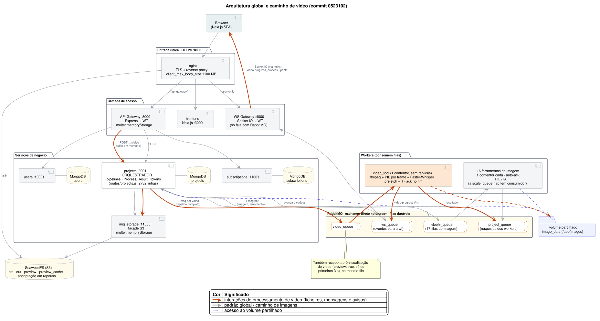
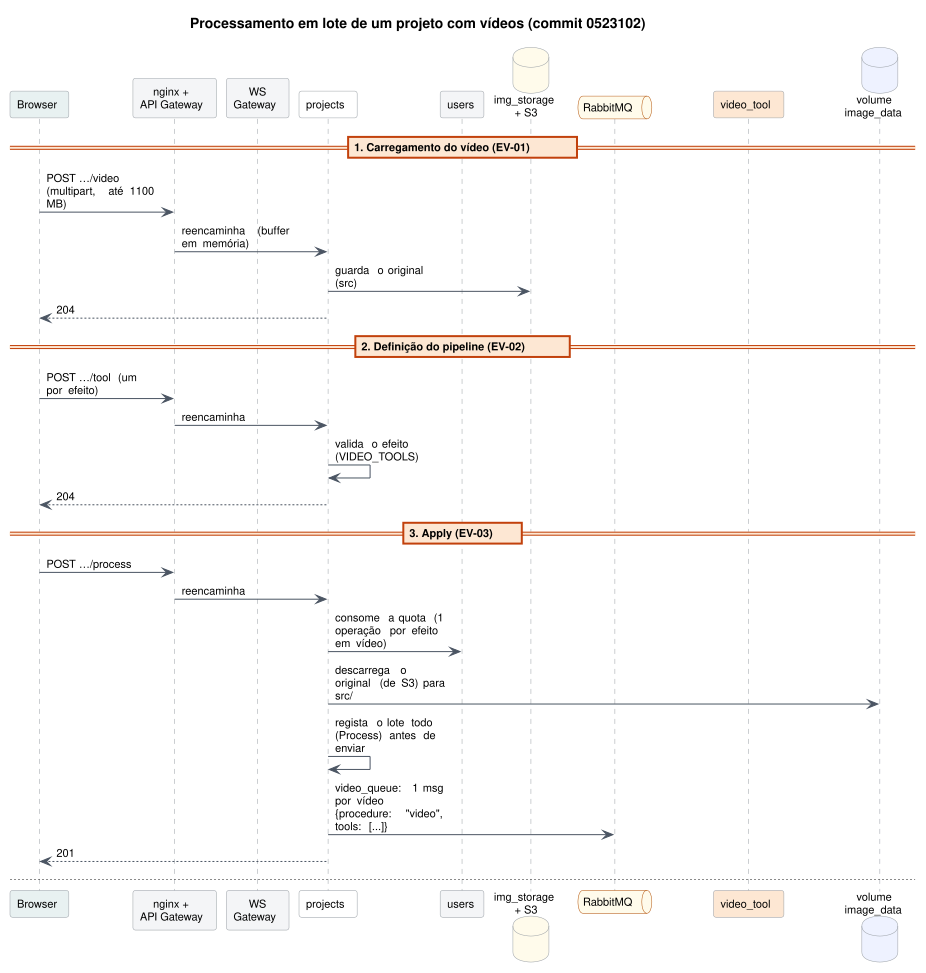
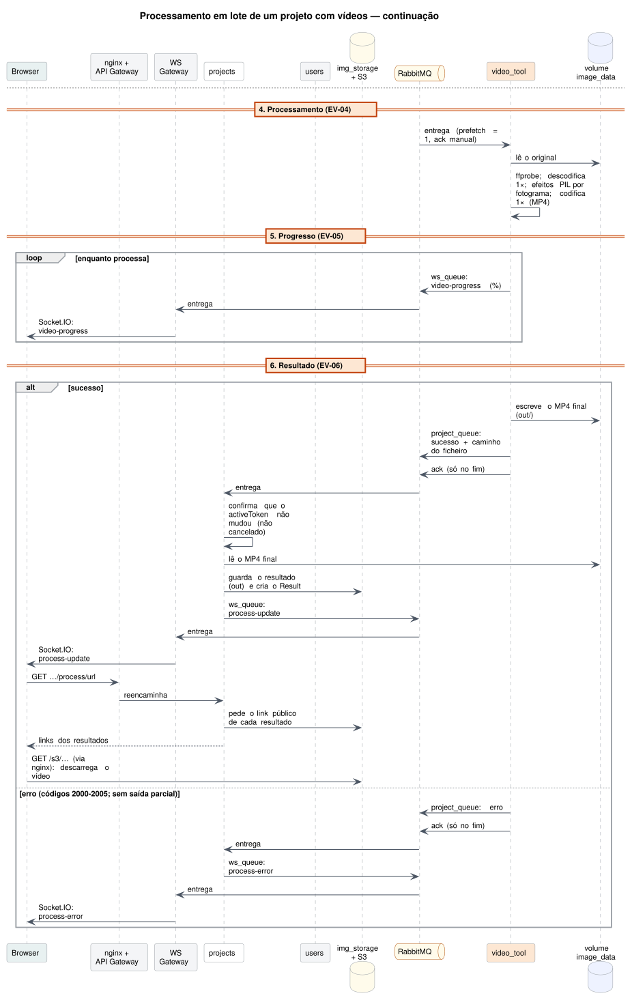

# 📝 Exercício 6 (Bloco 1) — Identificação e Comparação de Padrões Arquiteturais
### Fase 2: Melhoria de Requisitos Não Funcionais do PictuRAS

**Equipa:** {PL1-Gy}  
**Elementos:** pg63924 Beatriz Miranda · pg63944 Diogo Machado · pg63990 José Cação · pg63975 Inês Ribeiro · pg64020 Pedro Braz  
**Commit de partida:** `0523102` (`picturas-um/picturas-27`, ramo `main`)  
**Data da análise:** 2026-11-21  
**Versão deste documento:** v1.1 (revista a 2026-11-22)  
**Versões usadas:** enunciado 1.1 · template 1.1

---

## 0. Preparação e ambiente

| **Item** | **Valor** |
|----------|-----------|
| Commit de partida | `052310226c51fa57a17101c7bd1ad795674aac95` (`0523102`) |
| Comando(s) de arranque | `docker compose up -d --build` |
| Ambiente (SO, CPU, RAM, versões de Docker e Compose) | AMD Ryzen 5 5600H, 15,9 GB de RAM, Windows 11 Home; Docker Desktop (Engine 29.8.0, Compose 5.5.1) sobre WSL2 (kernel 6.18.58.1); 12 CPUs e 7,7 GiB atribuídos ao Docker |
| Projeto de teste (nº de imagens e de vídeos, amostras usadas) | {projeto criado na interface com N imagens e M vídeos de `samples/video/`: preencher}. Para as medições: utilizadores Premium de teste, um projeto por trabalho, criados por `docs/fase2/medicoes/carga_rnf1.py`. Amostras de `samples/video/`: `sample_10s_720p.mp4` (edição curta) e `speech_mandela_177s_1080p.webm` (legendagem). Imagens de teste das ferramentas de imagem em `regressao_hashes.py` |
| Problemas encontrados ao lançar | `docker compose up -d` sem `--build` reutilizou imagens antigas com o mesmo nome de projeto (`picturas-*`), construídas a partir do código da Fase 1 da equipa. Detetado porque os testes dentro do contentor `projects` não eram os do repositório. Reconstruído com `--build`; desde então usa-se sempre `--build`. Testes existentes depois disso: `projects/tests` 8/8 e `Tools/video/tests` 74/74 passam |

**Como é orquestrado o processamento em lote de imagens e de vídeos** *(5 a 8 linhas)*:

> [PROPOSTA] Rascunho: o enunciado pede que seja escrito pela equipa, com palavras próprias. Rever e reescrever.

Um projeto tem uma lista ordenada de ferramentas e um conjunto de ficheiros, que podem ser imagens ou vídeos. No
*Apply*, o serviço `projects` cria um trabalho por ficheiro e só envia as mensagens depois de registar o lote inteiro.
O tipo de cada ficheiro, guardado no carregamento, decide o caminho. Uma **imagem** percorre a cadeia de microserviços
de imagem, um passo de cada vez: cada ferramenta tem a sua fila, devolve o resultado na `project_queue`, e é o
`projects` que envia a saída para a fila da ferramenta seguinte. Um **vídeo** vai inteiro, com a lista completa de
ferramentas, para uma única fila (`video_queue`), onde o `video_tool` aplica todos os passos de uma vez: efeitos
fotograma a fotograma, corte, velocidade, legendas e extração de fotogramas. O progresso chega ao browser pelo
`ws_gateway`. No fim, o `projects` regista o resultado da execução, desde que esta não tenha sido cancelada entretanto.

---

## 1. Âmbito e vista da arquitetura

### 1.1 Fontes consultadas

| **Fonte** | **Versão / data** | **Usada para** |
|-----------|-------------------|----------------|
| `README.md` | `0523102` | Arranque, serviços e amostras de vídeo |
| `AGENTS.md` | `0523102` | Convenções do repositório e organização dos serviços |
| `doc-ext-requisitos-2627.pdf` (extensão de vídeo do PL1-G4) | versão distribuída com a Fase 2 | Requisitos REQ-VID-EDIT-009 a -014, decisões de qualidade DQ-01 a DQ-07 (secção 2.5) e decisões arquiteturais do PL1-G4 (secção 8.2, Tabela 37, DA-01 a DA-10) |
| `doc-sol-arquitetural.pdf` (solução da base anterior) | {versão} | {confirmar se foi consultado e para quê; as decisões do PL1-G4 estão no documento de extensão} |
| Diretrizes da Fase 2 | V1 (2026-11-04) | Âmbito: dois RNF, por *refactoring*, sem novas funcionalidades |
| Slides da aula 11 (*Arch. Styles*) | 2026/2027 | Identificação dos padrões (secção 2) e alternativas (secção 3) |
| `RAS_support_doc_architectural_patterns_PT.md` | 2026/2027 | Padrões considerados: microserviços, *Pipes and Filters*, *Competing Consumers*, monólito modular |
| Código e configuração (`docker-compose.yaml`, `nginx/nginx.conf`, `apiGateway/`, `rabbitMQ/definitions.json`, `projects/`, `Tools/video/`, `Tools/utils/`, `imageStorageService/`, `wsGateway/`) | `0523102` | Evidências `EV-nn` |
| Hohpe & Woolf, *Enterprise Integration Patterns* (2003); Richards & Ford, *Fundamentals of Software Architecture* (2020) | — | *Competing Consumers*; *pipeline* e monólito modular |
| Medições da equipa (`docs/fase2/medicoes/`) | 2026-11-18 | Evidências de medição (EV-17, EV-18) |

### 1.2 Vista da arquitetura global

Diagrama fornecido pelos docentes com o Ex. 6 (`arquitetura_global_plantuml.svg`), com a fonte em `relatorio/images/arquitetura_global.puml` e quatro acrescentos verificados no *commit* `0523102`: (1) seta `ws_gateway` → browser (progresso por Socket.IO); (2) nota: a pré-visualização também usa a `video_queue`; (3) *commit* no título; (4) 17 filas de imagem (`rabbitMQ/definitions.json`), não 16.

**Ferramenta / notação:** PlantUML, diagrama de componentes.

| **Elemento (cor, forma ou estilo)** | **Significado** |
|-------------------------------------|-----------------|
| Seta laranja grossa | Interações do processamento de vídeo: ficheiros (*upload*, escrita no volume, S3), mensagens (`projects` → `video_queue` → `video_tool` → `project_queue`) e avisos (`ws_queue` → `ws_gateway` → browser). As setas mostram quem comunica com quem, não o percurso do ficheiro de vídeo |
| Componente | Contentor Docker (um serviço do `docker-compose.yaml`) |
| Fila | Fila do RabbitMQ (17 filas de ferramentas de imagem, `video_queue`, `project_queue`, `ws_queue`) |
| Base de dados / armazenamento | MongoDB por serviço; SeaweedFS (bucket único `users/<id>/`); volume partilhado `image_data` |

### 1.3 Diagrama de sequência de um pedido completo

Diagrama de sequência em PlantUML com os 6 passos da tabela (fonte em `relatorio/images/sequencia_pedido.puml`), dividido em duas partes para ficar legível em A4.

| **Passo** | **Origem → Destino** | **Mensagem / endpoint / fila** | **Evidência** |
|-----------|----------------------|--------------------------------|---------------|
| Carregamento do vídeo | browser → `nginx` → `api_gateway` → `projects` → `img_storage` → SeaweedFS | `POST /:user/:project/video` (multipart, campo `video`), até 1100 MB | EV-01 |
| Definição do pipeline | browser → `api_gateway` → `projects` | `POST /:user/:project/tool`; as ferramentas de vídeo são as de `VIDEO_TOOLS` | EV-02 |
| *Apply* | browser → `projects` → RabbitMQ | `POST /:user/:project/process`; uma mensagem por ficheiro; para vídeo, `procedure: "video"` com a lista completa de ferramentas, na `video_queue` | EV-03 |
| Processamento | `video_queue` → `video_tool` | consumo com `prefetch_count=1`, `auto_ack=False`; `process_video` corre o pipeline ffmpeg de uma vez | EV-04 |
| Progresso | `video_tool` → `ws_queue` → `ws_gateway` → browser | mensagens de progresso em percentagem (WebSocket) | EV-05 |
| Resultado | `video_tool` → `project_queue` → `projects` → browser | sucesso ou erro (códigos 2000–2005); o `projects` só regista a execução se o `activeToken` não tiver mudado (cancelamento) | EV-06 |

### 1.4 Onde e porquê o sistema bifurca entre imagem e vídeo

| **Ponto de bifurcação** | **Caminho de imagens** | **Caminho de vídeo** | **Evidência** | **Porquê** (facto ou hipótese) |
|-------------------------|------------------------|----------------------|---------------|--------------------------------|
| Carregamento | `POST /:user/:project/img` (campo `image`) | `POST /:user/:project/video` (campo `video`); o ficheiro fica com `media_type: "video"` | EV-01 | Facto: os vídeos têm limites e validações próprios (formato, duração); o tipo guardado decide o caminho no *Apply* |
| Definição do pipeline | Ferramentas de imagem | Só as de `VIDEO_TOOLS`; `trim` e `speed` ficam associados a um vídeo (`PER_VIDEO_TOOLS`) | EV-02 | Facto: há ferramentas que só existem para vídeo (`VIDEO_ONLY_TOOLS`) |
| *Apply* (encaminhamento) | Uma mensagem por passo, para a fila de cada ferramenta | Uma mensagem com todos os passos, para a `video_queue` | EV-03 | Facto (`doc-sol-arquitetural.pdf`, decisão do PL1-G4): evitar descodificar e recodificar o vídeo em cada passo |
| Processamento | Um microserviço por ferramenta, `auto_ack=True` | Um só serviço (`video_tool`), `ack` manual no fim | EV-09, EV-10 | Facto: o vídeo é longo e não pode perder-se a meio; a imagem é curta |
| Pré-visualização | Pela cadeia de imagem | Também pela `video_queue`, com `preview: true` (só os primeiros segundos) | EV-16 | Facto: o mesmo serviço trata pré-visualização e processamento final; por isso disputam o mesmo *worker* |

---

## 2. Identificação e análise dos padrões atuais

### 2.1 Padrão global da solução

| | |
|---|---|
| **Nome(s) do padrão / estilo** | Microserviços com entrada única (*reverse proxy* + *API Gateway*), comunicação assíncrona por mensagens (filas ponto-a-ponto num *broker*, RabbitMQ: cada mensagem é uma ordem para uma ferramenta; só a `ws_queue` leva eventos de progresso para a interface) e orquestração central pelo serviço `projects`; pedidos REST síncronos entre `apiGateway`, `projects` e `imageStorageService`; *Layered* dentro dos serviços Node (`projects`, `users`, `subscriptions`) |
| **Descrição** | Cada ferramenta de imagem é um microserviço com a sua fila. O `projects` envia cada passo de um trabalho para a fila da ferramenta e recebe todos os resultados numa fila única (`project_queue`), a partir da qual decide o passo seguinte. O progresso segue por outra fila (`ws_queue`) até ao `ws_gateway`. Todo o tráfego entra pelo `nginx` (EV-20), cada serviço de domínio tem a sua base de dados e tudo é implantado com Docker Compose (EV-21). O padrão *Competing Consumers* é possível, mas não é usado: cada fila tem um único consumidor. |

**Decisões globais que condicionam o vídeo**

| **Decisão global** | **Evidência** | **Efeito no vídeo** |
|--------------------|---------------|---------------------|
| Entrada única: `nginx` encaminha a interface, a API (`/api-gateway/`), o WebSocket (`/socket.io`) e o armazenamento (`/s3/`) | EV-01, EV-20 | Os carregamentos de vídeo passam pelos mesmos saltos que os de imagem, com o limite de 1100 MB |
| Comunicação assíncrona por filas, declaradas centralmente, com resultados centralizados na `project_queue` | EV-03, EV-06, EV-22 | O vídeo usa o mesmo contrato de mensagens (`messageId`, `procedure`, `parameters`) e a mesma fila de resultados; o cancelamento e o registo do resultado são decididos no `projects` |
| Um contentor por serviço, sem réplicas nem limites de recursos | EV-07 | Todo o trabalho de vídeo é processado por uma única instância |
| Armazenamento de *media* por pedidos REST síncronos ao `img_storage` (SeaweedFS) | EV-23 | O `projects` descarrega e guarda vídeos inteiros pelo mesmo serviço de armazenamento das imagens |
| Base de dados própria por serviço de domínio; implantação com Docker Compose | EV-21 | O vídeo não tem estado próprio: o estado do trabalho fica no `projects`; a capacidade define-se no `docker-compose.yaml` |
| Organização em camadas dentro dos serviços Node (rotas → controladores → modelos) | EV-24 | A lógica de vídeo do orquestrador está nas rotas (`projects.js`), junto da de imagem |
| Armazenamento intermédio partilhado entre *workers* | EV-08 | Os ficheiros intermédios do vídeo (MP4 por estágio, fotogramas) vivem no mesmo volume que os das imagens |
| *Workers* de imagem confirmam as mensagens à receção | EV-09 | O vídeo afasta-se: confirma só no fim (EV-04), por isso, se o `video_tool` falhar a meio, a mensagem volta à fila e não se perde |

**Benefícios e desafios do padrão global**

| **Tipo** | **Descrição** | **Característica / subcaracterística (ISO/IEC 25010)** | **Facto / hipótese** |
|----------|---------------|--------------------------------------------------------|----------------------|
| Benefício | Cada ferramenta de imagem é um serviço com a sua fila: muda, reconstrói-se e reimplanta-se sozinha. Exceção: 14 das 16 ferramentas de imagem (e o `video_tool`) copiam a pasta partilhada `Tools/utils` no Dockerfile, por isso uma mudança em `utils` reconstrói-as todas | Manutenibilidade → modularidade | EV-08, EV-22, EV-28 |
| Benefício | O *broker* desacopla o `projects` dos *workers*: um *worker* lento não bloqueia o pedido HTTP do *Apply* | Eficiência de desempenho → comportamento temporal | EV-03, EV-04 |
| Desafio | Com um consumidor por fila, a capacidade de cada ferramenta é a de um único contentor | Eficiência de desempenho → capacidade | EV-07 |
| Desafio | Com `auto_ack=True`, uma falha de um *worker* de imagem perde a mensagem | Fiabilidade → tolerância a falhas | EV-09 |
| Desafio | O orquestrador concentra a lógica de encadeamento, cancelamento e quota: `projects/routes/projects.js` tem 2733 linhas, 16 delas com ramificação imagem/vídeo | Manutenibilidade → modificabilidade | EV-06, EV-17 |

### 2.2 Padrão do processamento de vídeo

| | |
|---|---|
| **Nome do padrão** | *Pipes and Filters* em processo, concentrado num único serviço (`video_tool`) dentro de uma arquitetura de microserviços. Neste documento chamamos-lhe, para abreviar, *pipeline monolith* |
| **Descrição** | Um único serviço, `video_tool`, recebe o trabalho inteiro e executa todas as ferramentas num só processo. Um descodificador ffmpeg entrega fotogramas, os efeitos PIL são aplicados a cada um, e um codificador produz a saída. A legendagem (Faster-Whisper) e a extração de fotogramas correm no mesmo processo e na mesma imagem Docker. |
| **Contraste com o caminho de imagens** | Nas imagens, cada ferramenta é um serviço e o `projects` encadeia os passos. No vídeo, o encadeamento é interno ao `video_tool`. A decisão do PL1-G4 evita descodificar e recodificar o vídeo inteiro em cada passo, mas obriga a reimplementar no vídeo os efeitos que já existem nas imagens. |

**Benefícios e desafios do padrão do vídeo**

| **Tipo** | **Descrição** | **Característica / subcaracterística (ISO/IEC 25010)** | **Facto / hipótese** |
|----------|---------------|--------------------------------------------------------|----------------------|
| Benefício | Uma só codificação por pipeline (sem legendas), o que dá menos tempo e menos perda de qualidade | Eficiência de desempenho → comportamento temporal | EV-27; exceção com legendas: EV-15 |
| Benefício | Confirmação no fim (`ack` manual): se o processo morrer, o RabbitMQ volta a entregar a mensagem | Fiabilidade → recuperabilidade | EV-04, EV-10 |
| Benefício | Escrita atómica da saída: não ficam saídas parciais em caso de falha | Fiabilidade → tolerância a falhas | EV-25 |
| Desafio | Uma legendagem longa ocupa o único *worker*; trabalhos curtos que chegam depois ficam à espera | Eficiência de desempenho → capacidade | EV-04, EV-07, EV-10, EV-18 |
| Desafio | Os 8 efeitos estão implementados duas vezes (imagem e vídeo); uma correção tem de ser feita nos dois sítios | Manutenibilidade → modularidade, modificabilidade | EV-12, EV-17 |
| Desafio | Qualquer mudança (efeitos, legendas, extração) reconstrói e reimplanta o serviço que serve os três tipos de trabalho | Manutenibilidade → modularidade | EV-11, EV-13, EV-14 |

### 2.3 Relação entre o padrão global e o padrão do vídeo

| **Aspeto** | **O que o padrão global prescreve** | **O que o vídeo faz** | **Segue / afasta-se** | **Consequência** | **Evidência** |
|------------|-------------------------------------|-----------------------|-----------------------|------------------|---------------|
| Comunicação | Mensagens assíncronas; resultados na `project_queue` | Igual | Segue | O vídeo partilha o contrato e o cancelamento do `projects` | EV-03, EV-06 |
| Granularidade | Um serviço e uma fila por ferramenta | Um serviço e uma fila para todas as ferramentas e tipos de trabalho | Afasta-se | Efeitos duplicados; uma mudança reimplanta tudo | EV-11, EV-12 |
| Encadeamento | Feito pelo `projects`, passo a passo | Feito dentro do `video_tool` (`process_video`) | Afasta-se | O orquestrador conhece as ferramentas de vídeo mas não encadeia os passos; a lógica fica repartida | EV-02, EV-13 |
| Capacidade | Um consumidor por fila | Um consumidor, `prefetch_count=1`, trabalhos longos | Segue | No vídeo, o efeito é muito maior: um trabalho de 5 min bloqueia todos os outros | EV-04, EV-07 |
| Confirmação das mensagens | `auto_ack=True` | `ack` manual no fim | Afasta-se | Melhor recuperação no vídeo; com réplicas, é a base do *Competing Consumers* | EV-09, EV-10 |
| Armazenamento intermédio | Volume partilhado `image_data` | Igual (MP4 intermédios no mesmo volume) | Segue | Com réplicas, os nomes temporários não podem colidir (H-02) | EV-08, EV-15 |

**O que o vídeo herda do padrão global / que restrições este lhe impõe / que fragilidades resultam do desvio** *(3 a 6 linhas)*:

O vídeo herda do padrão global o contrato de mensagens, a fila de resultados e o controlo de cancelamento e quota no
`projects`. Herda também a restrição de capacidade: um consumidor por fila, sem réplicas (EV-07). Afasta-se na
granularidade, ao concentrar edição, legendagem e extração num só serviço, o que evita recodificações mas cria duas
fragilidades. A primeira é de **capacidade**: um trabalho longo ocupa o único *worker* e bloqueia os outros (EV-04,
EV-10). A segunda é de **modularidade**: os efeitos estão duplicados e qualquer mudança reconstrói e reimplanta os três
tipos de trabalho (EV-11, EV-12, EV-14).

### 2.4 Legendagem automática e extração de fotogramas

| **Funcionalidade** | **Como se integra no padrão do vídeo** | **Impacto nos atributos de qualidade** | **Evidência** |
|--------------------|----------------------------------------|-----------------------------------------|---------------|
| Legendagem automática | Dentro do `video_tool`, como mais uma ferramenta da lista. `process_video` parte o pipeline em estágios à volta das legendas, com um MP4 intermédio por estágio (`stage-N.mp4`). O modelo Faster-Whisper `small` corre com 2 *threads*, e as fontes CJK para as legendas estão na mesma imagem | Capacidade ↓: uma legendagem de 177 s ocupa o *worker* cerca de 5 min (EV-18). Modularidade ↓: o `faster-whisper` (457 MB) e as fontes (parte dos 597 MB) estão em todas as instâncias, mesmo nas que só cortam vídeo. Comportamento temporal: uma recodificação extra por estágio | EV-07, EV-11, EV-14, EV-15, EV-18 |
| Extração de fotogramas | Dentro do `video_tool`; tem de ser a última ferramenta. Se houver edição antes, a extração corre sobre o vídeo editado (progresso dividido 70/30). Na pré-visualização devolve uma folha de contactos | Modularidade ↓: a regra «extração no fim» está em `process_video`, junto das restantes (CC 22). Mudar a amostragem reimplanta os três tipos de trabalho (cenário C3) | EV-13, EV-17 |

### 2.5 Suporte aos requisitos não funcionais existentes e regras sem requisito explícito

| **Requisito / regra** (ID, ou «sem requisito explícito») | **Padrão global suporta?** | **Padrão do vídeo suporta?** | **Porquê** | **Evidência** |
|----------------------------------------------------------|----------------------------|------------------------------|------------|---------------|
| REQ-VID-EDIT-009 — resultados reproduzíveis para a mesma entrada e sequência | Sim | Sim | Processamento determinista; o mesmo vídeo e os mesmos efeitos dão os mesmos fotogramas | EV-10; `regressao_hashes.py` |
| REQ-VID-EDIT-010 — editar um vídeo em até 1× a sua duração (MVP: 5×) | Sim | Parcial | Sozinho, um vídeo de 10 s demora p95 17,8 s (≈ 1,8×); com uma legendagem em curso, mais de 300 s | EV-18 |
| REQ-VID-EDIT-011 — vários vídeos em paralelo quando há capacidade (MVP: ≥ 2) | Parcial | Não | Um consumidor por fila; um só `video_tool`, com `prefetch_count=1` | EV-04, EV-07, EV-18 |
| REQ-VID-EDIT-013 — acrescentar um efeito sem alterar os existentes | Sim | Parcial | Um efeito novo de vídeo entra em `effects.py` e em `process_video`, partilhados por todos; se existir também para imagem, tem de ser escrito duas vezes | EV-12, EV-13 |
| REQ-VID-EDIT-014 — edição só com componentes isolados no seu serviço | Sim | Sim | ffmpeg, PIL e Faster-Whisper estão na imagem do `video_tool`; nada é instalado na máquina | EV-14 |
| REQ-VID-FAIL-004 — confirmação manual da mensagem | Não (`auto_ack=True` nas imagens) | Sim | `ack` só no fim do processamento | EV-09, EV-10 |
| Sem requisito explícito — o mesmo efeito dá o mesmo resultado em imagem e em vídeo | — | Parcial | Garantido por cópia do código das ferramentas de imagem, que pode divergir | EV-12 |
| Sem requisito explícito — a extração de fotogramas é sempre o último passo | — | Sim | Regra em `process_video` | EV-13 |
| Sem requisito explícito — o resultado de uma execução cancelada não é registado | Sim | Sim | Verificação do `activeToken` no `projects` | EV-06 |

### 2.6 Registo de evidências e hipóteses

| **ID** | **Tipo** | **Localização** (ficheiro e linhas, commit, comando) | **O que mostra** |
|--------|----------|------------------------------------------------------|------------------|
| EV-01 | Configuração / Código | `nginx/nginx.conf:13`, `apiGateway/routes/projects.js:23`, `projects/routes/projects.js:72, 1392`, `imageStorageService/route/upload.js:6` | O ficheiro carregado é recebido inteiro em memória (`multer.memoryStorage`) em cada salto, com limite de 1100 MB; os vídeos têm rota própria (`/video`) |
| EV-02 | Código | `projects/routes/projects.js:1397`, `projects/utils/video.js:16-25` | O orquestrador conhece as listas `VIDEO_TOOLS`, `VIDEO_ONLY_TOOLS` e `PER_VIDEO_TOOLS` |
| EV-03 | Código | `projects/routes/projects.js:1521, 1665-1672`, `projects/utils/project_msg.js:21, 26-40` | O *Apply* regista o lote todo e só depois envia; todo o trabalho `video` vai para uma única fila, `video_queue` |
| EV-04 | Código | `Tools/video/video.py:51-54, 172-175` | `prefetch_count=1` e `auto_ack=False`: cada consumidor recebe uma mensagem de cada vez e confirma-a manualmente |
| EV-05 | Código | `Tools/video/video.py:112-124` | O progresso é publicado na `ws_queue` |
| EV-06 | Código | `Tools/video/video.py:76-110`, `projects/routes/projects.js:232-233, 440` | Respostas na `project_queue`; o `projects` só regista a execução se o `activeToken` não tiver mudado |
| EV-07 | Configuração | `docker-compose.yaml:256-273` | Um único serviço `video_tool`, sem `deploy.replicas` nem limites de recursos, com `restart: on-failure`; `WHISPER_MODEL: small`, `WHISPER_CPU_THREADS: 2` |
| EV-08 | Configuração | `docker-compose.yaml` (todos os serviços `*_tool`) | Todos os *workers* montam o volume `image_data` (em `/app/images`; o `watermark_tool_ms`, que usa uma imagem pré-construída, em `/images`) |
| EV-09 | Código | `Tools/utils/rabbit_mq.py:40` | As ferramentas de imagem usam `auto_ack=True` |
| EV-10 | Código | `Tools/video/video.py:126-170` | O `callback` corre `process_video` de forma síncrona e só faz `basic_ack` no fim (l. 170) |
| EV-11 | Código | `Tools/video/` | Edição (`video_processor.py`), legendagem (`subtitles.py`) e extração (`frame_extraction.py`) no mesmo processo; 807 linhas de Python (contando comentários e linhas em branco; só código, 601 SLOC, EV-17) |
| EV-12 | Código | `Tools/video/effects.py:1-6, 11-41` | 8 efeitos que, segundo o próprio ficheiro, «mirror exactly» os microserviços de imagem |
| EV-13 | Código | `Tools/video/video_processor.py:286-369` | `process_video` decide a extração no fim, os estágios à volta das legendas e a regra da pré-visualização; complexidade ciclomática 22 |
| EV-14 | Configuração / Medição | `Tools/video/Dockerfile`, `Tools/video/requirements.txt`; `docker image inspect picturas-video_tool` | Uma só imagem de 1,69 GB: ffmpeg e fontes CJK (597 MB) e `faster-whisper` (457 MB); *build* sem *cache* de 240 s |
| EV-15 | Código | `Tools/video/video_processor.py:321-366` | Com legendas, o pipeline já corre em estágios separados, cada um com um MP4 intermédio (`stage-N.mp4`) |
| EV-16 | Código | `projects/routes/projects.js:1082-1150` | A pré-visualização de vídeo também vai para a `video_queue` (`procedure: "video"`, `preview: true`) |
| EV-17 | Medição | `rnf2_estaticas.py base` (comando no cabeçalho do *script*) → `docs/fase2/medicoes/resultados/base/rnf2_estaticas.json` | 8 efeitos com duas implementações (18 linhas copiadas); nos cenários de mudança C1, C2 e C3 os 3 tipos de trabalho são reimplantados; 601 SLOC no vídeo; orquestrador com 2733 linhas, 16 com ramificação imagem/vídeo |
| EV-18 | Medição | `carga_rnf1.py base m1` e `carga_rnf1.py base isolado` → `resultados/base/carga_m1_resumo.json`, `carga_isolado_resumo.json` | Brilho num vídeo de 10 s, submetido 5 s depois de uma legendagem de 177 s: p95 322,6 s (p50 307,6 s; 5 repetições). Sozinho: p95 17,8 s. Memória máxima do `video_tool`: 2 506 MiB (≈ 2,4 GiB) |
| EV-19 | Configuração | `rabbitMQ/Dockerfile:2`, `rabbitMQ/rabbitmq.conf` | RabbitMQ 4.0.5 sem `consumer_timeout` configurado (valor por omissão: 30 min) |
| EV-20 | Configuração | `nginx/nginx.conf:17-35, 64-65, 95-96` | Entrada única em HTTPS: `/` → `frontend`, `/api-gateway/` → `api_gateway`, `/socket.io` → `ws_gateway`, `/s3/` → SeaweedFS |
| EV-21 | Configuração | `docker-compose.yaml:112-126, 153-167, 186-197` | MongoDB próprio para `projects`, `users` e `subscriptions`, cada um com o seu volume; toda a solução é implantada com Docker Compose |
| EV-22 | Configuração | `rabbitMQ/definitions.json` | 20 filas declaradas: `project_queue`, `ws_queue`, `video_queue` e 17 filas de ferramentas de imagem |
| EV-23 | Código | `projects/utils/imageStorage.js:15-40` | O `projects` lê, carrega e apaga ficheiros no `img_storage` por pedidos HTTP síncronos |
| EV-24 | Código | `projects/`, `users/` e `subscriptions/` (pastas `routes/`, `controllers/`, `models/`) | Organização em camadas dentro dos serviços Node; as ferramentas Python não seguem esta organização |
| EV-25 | Código | `Tools/video/video_processor.py:172, 198-241` | A saída é escrita num ficheiro `.part.mp4` e só no fim é renomeada (`os.replace`); se falhar, o parcial é apagado |
| EV-26 | Medição | *(acrescentada no Bloco 2)* `carga_rnf1.py base paralelo --n 4` → `resultados/base/carga_paralelo_resumo.json` | 4 edições curtas em simultâneo, sem legendagem: p95 44,0 s (p50 28,8 s); 5,54 vídeos/min; uma só réplica |
| EV-27 | Código | `Tools/video/video_processor.py:201-217` | Um único processo ffmpeg descodifica o vídeo, `apply_frame_effects` aplica todos os efeitos do pipeline a cada fotograma e um único processo ffmpeg codifica a saída |
| EV-28 | Configuração | `Tools/<ferramenta>/Dockerfile:7` (`COPY ./utils ./utils`) | 15 Dockerfiles copiam a pasta partilhada `Tools/utils`: todas as ferramentas de imagem construídas no repositório, exceto `expand_ai`, e também o `video_tool` |
| EV-29 | Documento | `doc-ext-requisitos-2627.pdf`, secção 8.2, Tabela 37, DA-01 | O PL1-G4 rejeitou espalhar cada fotograma pelas filas de imagem (volume de mensagens, reordenação, sem lugar para o som nem para a recodificação) e optou por um *worker* que descodifica e recodifica uma só vez, «reutilizando os filtros como biblioteca», com «o paralelismo entre vídeos garantido por réplicas do worker» |
| EV-30 | Código | `apiGateway/auth/auth.js:12` | O API Gateway valida o JWT (`jwt.verify`) antes de reencaminhar os pedidos |
| EV-31 | Código | `apiGateway/routes/projects.js:18`, `users.js:10`, `subscriptions.js:13` | `rejectUnauthorized: false`: as ligações HTTPS internas não validam os certificados |
| EV-32 | Documento | `doc-ext-requisitos-2627.pdf`, secção 8.2, Tabela 37, DA-06 | O PL1-G4 replicou os filtros de imagem em `effects.py` porque cada ferramenta é um processo ligado ao RabbitMQ, sem uma função pura reutilizável; extrair uma biblioteca partilhada «mexia em todos os microsserviços de imagem e saía do âmbito de um MVP», e a duplicação ficou registada como «candidata a refactoring na Fase 2» |
| EV-33 | Código | `Tools/video/video.py:57-64` | A ligação ao RabbitMQ é aberta com `heartbeat=0`: o vídeo é processado na mesma *thread* que atende a ligação, e com *heartbeat* o broker fecharia a ligação a meio de um vídeo longo |
| EV-34 | Documento | `doc-ext-requisitos-2627.pdf`, secção 8.2, Tabela 37, DA-08 | O PL1-G4 desligou o *heartbeat* por isso mesmo; a alternativa correta, processar numa *thread* separada, «foi adiada», em troca de «o broker demorar mais a detetar um worker» com problemas |
| EV-35 | Código | `projects/utils/video.js:42-43` | Os vídeos Premium têm duração máxima de 600 s (`VIDEO_PREMIUM_MAX_DURATION_S`, por omissão); os Free, 60 s |

| **ID** | **Hipótese** | **Como confirmar ou refutar** | **Estado** |
|--------|--------------|-------------------------------|------------|
| H-01 | Com `docker compose up --scale video_tool=2`, a solução funciona sem erros (não há `container_name`; o `ack` é manual) | Repetir a medição de base com 2 réplicas manuais | Por confirmar |
| H-02 | Réplicas a escrever no mesmo `image_data` (EV-08) não colidem nos ficheiros temporários | Ler `video_processor.py`; dois trabalhos do mesmo projeto em simultâneo | Por confirmar |
| H-03 | Duas réplicas a descarregar o modelo Whisper ao mesmo tempo corrompem a *cache* `whisper_models` | Arrancar 2 réplicas com o volume vazio | Por confirmar |
| H-04 | Uma legendagem longa ultrapassa o `consumer_timeout` (EV-19, 30 min por omissão) e é reentregue em ciclo | Medir a legendagem do vídeo Premium mais longo permitido (600 s, EV-35), sozinha e com 2 em paralelo, e comparar com o `consumer_timeout` | Por confirmar — pouco provável com a configuração atual: os vídeos Premium têm no máximo 600 s (EV-35) e, pelo M1, 177 s de vídeo levam ~300 s a legendar (EV-18), o que dá ~17 min para 600 s |
| H-05 | O cancelamento (`activeToken`) continua correto com vários *workers* | Cancelar a meio com 2 réplicas ativas | Por confirmar |
| H-06 | Partir o pipeline nos limites dos estágios atuais (EV-15) não acrescenta recodificações | Contar as codificações nos *logs* do ffmpeg, antes e depois | **Confirmada** (2026-11-25, `apos-rnf2`): os *hashes* dos 9 pipelines de vídeo são iguais aos da base, o que não aconteceria com uma recodificação a mais (o H.264 tem perdas); e, na mesma máquina, o tempo não piorou (isolado −8 %, M6 −10 %). As codificações não foram contadas nos *logs* |
| H-07 | Os efeitos partilhados entre imagem e vídeo dão o mesmo resultado que hoje | *Hash* das saídas antes e depois (`regressao_hashes.py`) | **Confirmada** (2026-11-25, `apos-rnf2`): *hashes* iguais aos da base nas 8 ferramentas de imagem (9 casos) e nos 9 pipelines de vídeo |
| H-08 | O cancelamento e a devolução de quota funcionam com um pipeline que passa por vários serviços | Cancelar a meio de um pipeline legendas + filtro + extração | **Confirmada em parte** (2026-11-24): testes em `projects/tests/videoStageEnd.test.js` e, na aplicação, cancelar durante a edição não envia a legendagem, não regista resultados nem deixa ficheiros intermédios. A devolução da quota não foi verificada à parte (o código que a faz, no cancelamento, não mudou); falta a verificação manual (RNF2, T040) |
| H-09 | A divisão do vídeo faz crescer o orquestrador | Medir o tamanho do `projects` antes e depois (EV-17) | **Confirmada, mas pouco** (2026-11-25): `projects/routes/projects.js` passa de 2733 para 2816 linhas (+3 %, mínimo aceitável +10 %); as linhas com ramificação imagem/vídeo ficam iguais (16). O encadeamento ficou em módulos novos e testáveis (`videoStages.js`, `videoDispatch.js`) |
| H-10 | Retirar uma réplica a meio de um trabalho (e.g., quando o ajuste automático reduz réplicas com a fila vazia) faz o vídeo recomeçar do zero noutra réplica: o `ack` manual devolve a mensagem à fila (EV-10), sem perda mas com o tempo já gasto desperdiçado. Sem *heartbeat* (EV-33, EV-34), uma réplica bloqueada sem morrer também retém a mensagem até ao `consumer_timeout` (EV-19). | Com 2 réplicas, parar uma (`docker stop`) a meio de um vídeo e verificar nos *logs* se o vídeo recomeça noutra réplica e quanto tempo se perde; suspender uma réplica (`docker pause`) e medir quando a mensagem volta à fila. | Por confirmar |

---

## 3. Alternativas e matriz de comparação

### 3.1 Alternativas consideradas

| **ID** | **Nome / padrão** | **Descrição breve** | **Mantém ou altera o padrão global?** | **Fonte** |
|--------|-------------------|---------------------|---------------------------------------|-----------|
| ALT-1 | Um microserviço por efeito de vídeo (Microserviços + *Pipes and Filters* distribuído) | Cada ferramenta de vídeo passa a ser um serviço com a sua fila, como nas imagens; o `projects` encadeia os passos | Mantém (é o caminho das imagens) | Documento de apoio de padrões; caminho de imagens (EV-03) |
| ALT-2 | Um serviço por tipo de trabalho, com consumidores concorrentes (Microserviços + *Competing Consumers*) | Três serviços (edição, legendagem, extração), cada um com a sua fila e réplicas ajustadas pelo tamanho da fila; efeitos num módulo partilhado com as ferramentas de imagem; o `projects` encadeia os estágios | Mantém | Documento de apoio de padrões (*Competing Consumers*); estágios existentes (EV-15) |
| ALT-3 | Monólito modular com réplicas fixas | O `video_tool` mantém-se como um serviço, organizado internamente em módulos (registo de efeitos, legendagem, extração), e corre com N réplicas fixas | Afasta-se (como hoje) | Slides da aula 11 (monólito modular) |

Foi ainda considerada, e afastada logo à partida, uma alternativa com um *job* efémero por vídeo lançado por um
orquestrador de *workflows* (e.g., Kubernetes Jobs): daria isolamento total e elasticidade natural, mas exige outra
plataforma de execução, fora do âmbito de um *refactoring* e do prazo.

### 3.2 Análise de cada alternativa

**ALT-1 — Um microserviço por efeito de vídeo**

| | |
|---|---|
| **Coerência com o padrão global** | Total: o vídeo passa a seguir o mesmo desenho das imagens (EV-03) |
| **Efeito nos atributos de qualidade** | Modularidade ↑ (cada efeito muda sozinho). Comportamento temporal ↓↓: cada serviço descodifica e recodifica o vídeo inteiro. Capacidade ↑ (cada efeito escala sozinho) |
| **Vantagens potenciais** | Uniformidade; os efeitos podem ser os mesmos serviços das imagens, o que elimina a duplicação de EV-12 |
| **Desvantagens ou riscos** | Um pipeline de 3 filtros passa de 1 para 3 codificações: mais tempo e perda de qualidade (hoje há uma só, EV-27). Pelo mesmo motivo, o PL1-G4 rejeitou uma variante ainda mais fina, a de espalhar cada fotograma pelas filas de imagem (EV-29). Muitos MP4 intermédios em `image_data` (EV-08) |
| **Custo e risco de migração** (a funcionalidade existente tem de ser preservada) | Alto: o encadeamento passa todo para o `projects` (cresce o orquestrador, H-09); as saídas deixam de ser iguais bit a bit (mais codificações), o que torna impossível a regressão por *hash* (H-07) |

**ALT-2 — Um serviço por tipo de trabalho, com consumidores concorrentes**

| | |
|---|---|
| **Coerência com o padrão global** | Alta: serviços com filas próprias e encadeamento pelo `projects`. Usa o *Competing Consumers*, que o padrão global permite mas não usa |
| **Efeito nos atributos de qualidade** | Capacidade ↑↑ (cada tipo de trabalho tem a sua fila e as suas réplicas; a legendagem deixa de bloquear a edição). Modularidade ↑↑ (dependências separadas; efeitos num só módulo). Comportamento temporal ≈ (corta só nos estágios que já produzem um MP4 intermédio, EV-15; H-06) |
| **Vantagens potenciais** | Imagens Docker mais pequenas para a edição e a extração (sem `faster-whisper`, EV-14). A mudança do motor de legendas só reimplanta a legendagem. Retoma duas decisões do PL1-G4: o paralelismo entre vídeos por réplicas do *worker*, previsto na DA-01 mas não implementado (EV-07, EV-29), e a extração dos filtros para uma biblioteca partilhada, que a DA-06 adiou por sair do âmbito do MVP e deixou registada como candidata a *refactoring* na Fase 2 (EV-32) |
| **Desvantagens ou riscos** | Mais serviços e filas para operar; o ajuste automático de réplicas é uma peça nova. O cancelamento passa a atravessar vários serviços (H-05, H-08). O orquestrador pode crescer (H-09). Ao retirar réplicas, um vídeo a meio pode recomeçar do zero noutra réplica (H-10). Se o módulo de efeitos partilhado ficar em `Tools/utils`, uma mudança num efeito reconstrói 15 serviços (EV-28), o que piora o cenário de mudança C1: a localização do módulo tem de evitar este acoplamento |
| **Custo e risco de migração** | Médio: o código de cada tipo de trabalho já está em ficheiros separados (EV-11); o maior risco está no encadeamento e no cancelamento, cobertos pelos testes existentes (`Tools/video/tests`, `projects/tests`) e por testes novos para H-05 e H-08 |

**ALT-3 — Monólito modular com réplicas fixas**

| | |
|---|---|
| **Coerência com o padrão global** | Baixa, como hoje: um serviço para todos os tipos de trabalho |
| **Efeito nos atributos de qualidade** | Capacidade ↑ (N trabalhos em paralelo), mas fixa e partilhada: uma legendagem ocupa sempre uma réplica inteira. Modularidade ↑ apenas no código; a implantação continua única |
| **Vantagens potenciais** | Barata e com pouco risco: quase só configuração (`--scale`) e reorganização interna |
| **Desvantagens ou riscos** | Não resolve EV-14 (imagem única de 1,69 GB) nem os cenários de mudança (EV-17: os 3 tipos são reimplantados). Réplicas fixas gastam recursos sem carga e não chegam em pico. Depende de H-01 a H-03 |
| **Custo e risco de migração** | Baixo: quase só configuração (`--scale video_tool=N`) e reorganização interna do código, que já está repartido por ficheiros (EV-11). O risco está na concorrência entre réplicas no volume partilhado e na *cache* do Whisper (H-01 a H-03) |

### 3.3 Matriz de comparação de padrões

Escala: Alto / Médio / Baixo.

| **Atributo de qualidade (ISO/IEC 25010)** | **Padrão global atual (referência)** | **Padrão atual do vídeo** | **ALT-1** | **ALT-2** | **ALT-3** |
|-------------------------------------------|--------------------------------------|---------------------------|-----------|-----------|-----------|
| Relação com o padrão global | — | Afasta-se | Mantém | Mantém | Afasta-se |
| Eficiência de desempenho — comportamento temporal | Alto — passos curtos de imagem; o *Apply* responde sem esperar pelo processamento (EV-03) | Alto — uma descodificação e uma codificação por pipeline (EV-27) | Baixo — cada serviço descodifica e recodifica o vídeo inteiro: N codificações em vez de 1 (EV-27) | Alto — corta só nos estágios que já geram um MP4 intermédio (EV-15, H-06) | Alto — o mesmo código de processamento de hoje (EV-27) |
| Eficiência de desempenho — capacidade / elasticidade | Médio — um consumidor por fila, mas os trabalhos de imagem são curtos (EV-07, EV-22) | Baixo — um *worker*, `prefetch=1`, M1 p95 322,6 s (EV-04, EV-18) | Médio — cada efeito escala sozinho, mas cada vídeo passa por N serviços e N codificações (EV-27) | Alto — réplicas por tipo de trabalho, ajustadas à fila; a legendagem deixa de bloquear a edição (EV-18, H-01) | Médio — N réplicas fixas; cada legendagem ocupa uma réplica inteira (EV-18, H-01) |
| Fiabilidade — tolerância a falhas / recuperabilidade | Baixo — `auto_ack=True` perde mensagens (EV-09) | Médio — `ack` manual no fim, mas sem réplicas uma falha para a fila toda (EV-07, EV-10) | Médio — `ack` manual em cada serviço, mas mais saltos e mais MP4 intermédios que podem falhar (EV-08, EV-10) | Médio — `ack` manual; com réplicas, outra instância retoma a mensagem (EV-10, H-01); cancelamento entre serviços por confirmar (H-08) | Médio — igual ao atual, com réplicas (EV-10, H-01) |
| Manutenibilidade — modularidade / modificabilidade | Alto — um serviço e uma fila por ferramenta (EV-08, EV-22), exceto mudanças em `Tools/utils` (EV-28) | Baixo — 8 efeitos duplicados; uma mudança reimplanta 3 tipos (EV-12, EV-17) | Alto — cada efeito muda sozinho, mas o orquestrador passa a encadear todos os passos do vídeo (EV-17, H-09) | Alto — dependências separadas por tipo de trabalho (EV-14); efeitos num só módulo (EV-12), com o cuidado de EV-28 | Médio — módulos internos, mas uma só imagem e uma só implantação (EV-14, EV-17) |
| Segurança | Médio — o API Gateway valida o JWT (EV-30), mas as ligações internas não validam certificados (EV-31) | Médio — herda o global; o `video_tool` só fala com o RabbitMQ e com o volume (EV-08, EV-30) | Médio — igual ao global, com mais serviços a aceder ao volume (EV-08, EV-31) | Médio — igual ao global (EV-30, EV-31); o ajuste automático precisa de acesso à API do Docker, um risco novo a mitigar | Médio — igual ao atual (EV-30, EV-31) |
| Usabilidade — operabilidade | Alto — progresso por WebSocket (EV-05) | Médio — percentagem em tempo real (EV-05), mas um trabalho curto pode esperar 5 min sem explicação (EV-18) | Médio — mais lento por vídeo (N codificações, EV-27) | Alto — a edição deixa de esperar pela legendagem (EV-18, H-01) | Médio — depende do número de réplicas livres quando há legendagens em curso (EV-18, H-01) |

### 3.4 Adequação do padrão atual

O padrão global (microserviços com filas) é adequado e é o contexto que se mantém: dá modularidade no caminho das
imagens e desacopla o *Apply* do processamento. O padrão atual do vídeo foi uma escolha consciente do PL1-G4 para evitar
recodificações, e nesse ponto continua certo: a ALT-1 confirma que um serviço por efeito piora muito o comportamento
temporal. Mas o *pipeline monolith* é **pouco adequado** aos requisitos de capacidade (REQ-VID-EDIT-011) e de
modificabilidade (REQ-VID-EDIT-013): um trabalho curto espera 5 min atrás de uma legendagem (EV-18) e qualquer mudança
reimplanta os três tipos de trabalho (EV-17). A ALT-3 é a mais barata, mas só melhora parcialmente a capacidade e mantém
a implantação única. A **ALT-2** é a única que melhora as duas qualidades sem recodificações extra, porque corta nos
estágios que já existem (EV-15), e mantém a coerência com o padrão global.
