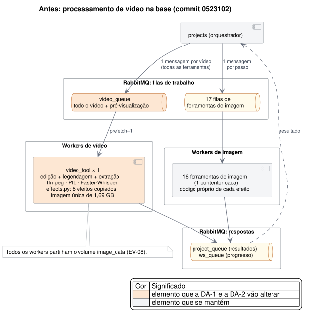
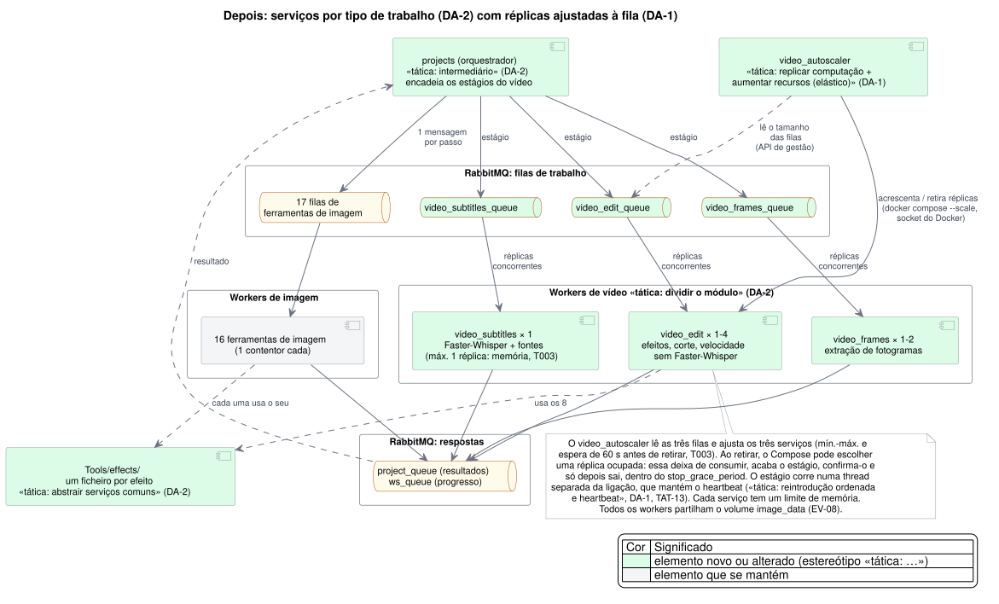

# 📝 Exercício 7 — Táticas Arquiteturais para Melhorar RNF do PictuRAS
### Fase 2: Melhoria de Requisitos Não Funcionais do PictuRAS

**Equipa:** {PLx-Gy}  
**Elementos:** pg63924 Beatriz Miranda · pg63944 Diogo Machado · pg63990 José Cação · pg63975 Inês Ribeiro · pg64020 Pedro Braz  
**Commit de partida:** `0523102` (o mesmo do Bloco 1)  
**Data da análise:** 2026-11-22  
**Versão deste documento:** v1.0  
**Versões usadas:** enunciado 3.0 · template 3.0  
**Versões do Bloco 1 e do Bloco 2 usadas como entrada:** v1.1 · v1.1 (`RAS-exercicio_6_bloco1_SWdesign_template_PT.md`, `RAS-exercicio_6_bloco2_SWdesign_template_PT.md`)

---

## 1. Cenários de entrada (do Bloco 2)

### 1.1 Candidatos e cenários

| **Candidato** | **Cenário** (`QS-nn` do Bloco 2) | **Característica / subcaracterística (ISO/IEC 25010)** | **Evidência** | **Origem** (padrão global / padrão do vídeo / interação) | **Estímulo a que a tática reage** | **Resposta e medida (resumo)** | **Escala e método (Bloco 2, secção 5.1)** |
|---------------|----------------------------------|--------------------------------------------------------|---------------|----------------------------------------------------------|-----------------------------------|--------------------------------|--------------------------------------------|
| CAND-1 | QS-03 (principal); QS-01 (complementar) | Eficiência de desempenho → capacidade | EV-04, EV-07, EV-10, EV-26 (QS-01: EV-18) | Interação entre o padrão do vídeo (*worker* único) e a restrição global de um consumidor por fila | Quatro utilizadores submetem ao mesmo tempo 4 edições de brilho a vídeos de 10 s | Os 4 trabalhos são processados em paralelo. Mede-se o tempo por trabalho (s, p50 e p95) e o débito (vídeos/min) | M6 com `carga_rnf1.py paralelo` (4 edições simultâneas, 5 repetições). Complementares M1 (`m1`) e M4 (`elasticidade_m4.py`, com os registos do `video_autoscaler`) |
| CAND-2 | QS-02 (principal); QS-04 (complementar) | Manutenibilidade → modularidade | EV-11, EV-13, EV-14, EV-17 | Padrão do vídeo (*pipeline monolith*) | Um programador atualiza a versão do `faster-whisper` ou o modelo de legendas | A mudança fica contida na legendagem. Mede-se o número de tipos de trabalho de vídeo reimplantados (contagem) | N2 (cenário C2) com `rnf2_estaticas.py`. Complementares N1, N3 e N4 |

### 1.2 Alterações feitas ao Bloco 2 (se existirem)

Nenhuma feita durante este exercício. Os cenários entram tal como estão no Bloco 2 v1.1, onde a equipa já tinha passado o
QS-03 a prioridade 1 e o M6 a escala principal do CAND-1 (Bloco 2, secções 4.2 e 5.2).

---

## 2. Táticas candidatas

As táticas seguem os mapas de Bass, Clements & Kazman (*Software Architecture in Practice*, 4.ª ed.). Para o QS-03
usam-se táticas de desempenho, que controlam a procura e gerem os recursos. Para o QS-02 usam-se táticas de
modificabilidade, que aumentam a coesão, reduzem o acoplamento e adiam a ligação. A TAT-13 é de disponibilidade. Como
nos slides da aula 7, uma tática de desempenho, neste caso réplicas que aparecem e desaparecem, cria a necessidade de
uma tática de disponibilidade, que passa a ser o seu pré-requisito.

| **ID** | **Cenário** | **Atributo → categoria** | **Tática** | **Como produz a resposta** (estímulo → tática → resposta) | **Já existe na base?** (evidência) | **Classe (A/B/C)** |
|--------|-------------|--------------------------|------------|-----------------------------------------------------------|------------------------------------|--------------------|
| TAT-01 | QS-03 | Desempenho → gerir recursos | Replicar computação, com várias instâncias de cada *worker* de vídeo a consumir da mesma fila (*Competing Consumers*) | 4 edições chegam → cada réplica livre consome uma mensagem → os 4 trabalhos correm em paralelo | Parcial — o `ack` manual (EV-10) e a ausência de `container_name` permitem réplicas (H-01), mas há uma só instância (EV-07) | A |
| TAT-02 | QS-03 | Desempenho → gerir recursos | Aumentar recursos de forma elástica, ajustando o número de réplicas ao tamanho de cada fila | A fila cresce → o ajuste acrescenta réplicas → o tempo de espera desce; a fila esvazia → as réplicas extra são retiradas | Não — não há ajuste nem réplicas (EV-07) | A |
| TAT-03 | QS-03 | Desempenho → gerir recursos | Introduzir concorrência dentro do *worker*, com `prefetch` > 1 e várias *threads* no mesmo contentor | 4 edições chegam → o mesmo contentor processa-as em *threads* paralelas | Não — `prefetch_count=1` e processamento na *thread* da ligação (EV-04, EV-10, EV-33) | A |
| TAT-04 | QS-03 | Desempenho → controlar a procura | Priorizar eventos, com uma fila que dá prioridade aos trabalhos curtos | Um trabalho curto chega → passa à frente dos longos **em espera** → mas não à frente do que está em curso | Não — a `video_queue` não tem prioridades (EV-22) | A |
| TAT-05 | QS-03 | Desempenho → controlar a procura | Gerir pedidos de trabalho, recusando ou adiando pedidos quando a fila passa um limite (*throttling*) | Muitos pedidos chegam → os excedentes são recusados com uma mensagem → os aceites esperam menos | Não | C |
| TAT-06 | QS-03 | Desempenho → gerir recursos | Aumentar recursos de cada contentor (mais CPU ou *threads* do ffmpeg por trabalho) | 4 edições chegam → cada uma termina um pouco mais depressa → mas continuam a ser feitas uma de cada vez | Parcial — `WHISPER_CPU_THREADS: 2` e ffmpeg com o número de *threads* por omissão (EV-07) | A |
| TAT-13 | QS-03 | Disponibilidade → recuperar (reintrodução ordenada) e detetar falhas (*heartbeat*) | Retirar uma réplica só depois de acabar o trabalho em curso. Ao receber o sinal de paragem, a réplica deixa de consumir, termina, confirma e sai. Além disso, o vídeo é processado numa *thread* separada da ligação, para o *heartbeat* voltar a estar ativo | O ajuste retira uma réplica ou uma réplica bloqueia → a réplica termina o vídeo antes de sair, ou o broker deteta o bloqueio pelo *heartbeat* e entrega a mensagem a outra → nenhum vídeo recomeça do zero nem fica preso 30 min | Parcial — o `ack` manual devolve a mensagem à fila se o processo morrer (EV-10), mas o *heartbeat* está desligado (EV-33) e a *thread* separada foi adiada pelo PL1-G4 (EV-34) | A |
| TAT-07 | QS-02 | Modificabilidade → aumentar a coesão | Dividir o módulo, com um serviço por tipo de trabalho (edição, legendagem, extração), cada um com o seu Dockerfile | Mudança no `faster-whisper` → só o serviço de legendagem muda e é reconstruído → edição e extração não são reimplantadas | Parcial — o código já está em ficheiros separados (EV-11), mas o serviço, o processo e a imagem são únicos (EV-13, EV-14) | A |
| TAT-08 | QS-02 | Modificabilidade → reduzir o acoplamento (abstrair serviços comuns) | Extrair os 8 efeitos para um módulo partilhado entre as ferramentas de imagem e o vídeo, com um ficheiro por efeito | Mudança num efeito (QS-04) → altera-se um só ficheiro → imagem e vídeo usam a mesma implementação | Não — 8 efeitos copiados (EV-12). A DA-06 do PL1-G4 deixou a extração para a Fase 2 (EV-32) | A |
| TAT-09 | QS-02 | Modificabilidade → reduzir o acoplamento (usar um intermediário) | Os serviços de vídeo só comunicam por filas, e o encadeamento dos estágios fica no `projects` | Os serviços de vídeo não se conhecem entre si → mudar um não obriga a mudar os outros | Parcial — o *broker* já é o intermediário entre o `projects` e os *workers* (EV-03), mas o encadeamento do vídeo é interno ao `video_tool` (EV-13) | A |
| TAT-10 | QS-02 | Modificabilidade → aumentar a coesão | Monólito modular, com um registo de efeitos e módulos internos no mesmo `video_tool` (ALT-3) | Mudança no `faster-whisper` → fica num módulo → mas a imagem e a implantação continuam únicas | Parcial — ficheiros separados (EV-11) | A |
| TAT-11 | QS-02 | Modificabilidade → adiar a ligação | Escolher o modelo de legendas por configuração | Trocar de modelo → muda-se uma variável de ambiente, sem alterar código | Sim — `WHISPER_MODEL` (EV-07), mas atualizar a biblioteca continua a reconstruir tudo | A |
| TAT-12 | QS-02 | Modificabilidade → aumentar a coesão | Dividir o módulo ao nível do efeito, com um serviço por efeito de vídeo (ALT-1) | Mudança num efeito → só esse serviço muda → mas cada serviço descodifica e recodifica o vídeo | Não — um só serviço trata todos os tipos de trabalho (EV-11) | A |

---

## 3. Decisões arquiteturais

As duas decisões realizam a ALT-2 do Bloco 1. Implementam-se pela ordem inversa da numeração, primeiro a DA-2
(modularidade), que é pré-requisito, e depois a DA-1 (capacidade). As medições fazem-se nos três momentos combinados
pela equipa, `base`, `apos-rnf2` e `apos-rnf1` (`docs/fase2/medicoes/README.md`, «Antes de medir»).

### DA-1 — Réplicas por serviço de vídeo com ajuste automático pelo tamanho da fila (cenário QS-03)

| **Campo** | **Conteúdo** |
|-----------|--------------|
| **Contexto** | Todo o vídeo é processado por um único *worker*, que trata uma mensagem de cada vez (EV-04, EV-07, EV-10). No QS-03, 4 edições curtas simultâneas demoram p95 44,0 s, contra 17,8 s de uma sozinha (EV-26). Depois da DA-2, cada tipo de trabalho tem a sua fila, mas cada fila continua com um só consumidor. A fase é de *refactoring*, por isso o utilizador tem de obter os mesmos resultados. |
| **Tática(s) escolhida(s)** | TAT-01 (replicar computação) e TAT-02 (aumentar recursos de forma elástica), com a TAT-13 (retirar réplicas só sem trabalho e *heartbeat* numa *thread* separada) como tática de disponibilidade pré-requisito. |
| **Estrutura / padrão que a realiza** | *Competing Consumers* em cada fila de vídeo. Um serviço novo, `video_autoscaler`, consulta periodicamente o tamanho de cada fila na API de gestão do RabbitMQ. Com esse valor, ajusta através da API do Docker o número de réplicas de `video_edit`, `video_subtitles` e `video_frames`, entre um mínimo e um máximo por serviço. Para a TAT-13, cada *worker* trata o sinal de paragem, ou seja, deixa de consumir, termina o vídeo em curso, confirma-o e sai. O `docker stop` dá-lhe tempo suficiente para isso. Além disso, o processamento passa para uma *thread* separada da ligação, com o *heartbeat* ativo. |
| **Alternativas consideradas e razão de rejeição** | *TAT-01 sozinha* (réplicas fixas). Melhora o M6, mas a capacidade não acompanha a carga (sem M4) e gasta memória sem trabalho, porque uma réplica com Whisper chegou a 2 506 MiB (EV-18). · *TAT-03* (concorrência no *worker*). A ligação ao RabbitMQ e o processamento estão na mesma *thread* (EV-33, EV-34), o cliente `pika` não é seguro entre *threads*, e várias legendagens no mesmo contentor disputam CPU e memória. · *TAT-04* (prioridades). Não acrescenta capacidade, porque com 4 trabalhos iguais a ordem não muda o p95. · *TAT-05* (*throttling*). É de classe C, porque o utilizador passaria a ver pedidos recusados. · *TAT-06* (mais recursos por contentor). Encurta cada trabalho, mas os 4 continuam em fila. |
| **Consequências positivas** | Vários pedidos em paralelo (M6) e cumprimento do critério do REQ-VID-EDIT-011 (≥ 2 vídeos em paralelo). A capacidade acompanha a carga e volta ao mínimo sem carga (M4). Se uma réplica falhar, outra continua a consumir a fila (o `ack` manual reentrega a mensagem, EV-10). |
| **Consequências negativas / riscos** | Gasta mais memória e CPU em pico, e o limite passa a ser a máquina (12 CPUs, 7,7 GiB). O `video_autoscaler` precisa de acesso ao *socket* do Docker, o que piora a segurança. Retirar uma réplica a meio de um vídeo obrigaria a recomeçá-lo (H-10). Sem *heartbeat*, uma réplica bloqueada reteria a mensagem até ao `consumer_timeout` (EV-19, EV-33). Os dois riscos ficam mitigados pela TAT-13, que por sua vez acrescenta concorrência entre *threads* a testar. Antes de ligar o ajuste, é preciso confirmar as hipóteses H-01 (réplicas sem erros), H-02 (ficheiros temporários no mesmo volume), H-03 (*cache* do Whisper), H-04 (`consumer_timeout`) e H-05 (cancelamento com vários *workers*). |
| **Elementos arquiteturais afetados** | A ligação ao RabbitMQ e o tratamento do sinal de paragem nos *workers* de vídeo (na base, em `Tools/video/video.py:57-64`, TAT-13). O `docker-compose.yaml`, com as réplicas, os limites e o tempo de paragem dos serviços de vídeo, e o serviço novo `video_autoscaler`, com o *socket* do Docker. O RabbitMQ, com a API de gestão e o `consumer_timeout` em `rabbitMQ/rabbitmq.conf`. E o volume `whisper_models`. |
| **Origem e âmbito do *refactoring*** | Interação entre o padrão do vídeo e o global, que passa a usar o *Competing Consumers* que o padrão global permite mas não usa. O risco de regressão é médio e concentra-se no cancelamento e na concorrência no volume partilhado. |
| **Classe (A/B/C)** | A — o utilizador não vê diferença funcional, apenas tempos de espera menores. |

### DA-2 — Um serviço por tipo de trabalho de vídeo e efeitos num módulo partilhado (cenário QS-02)

| **Campo** | **Conteúdo** |
|-----------|--------------|
| **Contexto** | Edição, legendagem e extração correm no mesmo processo e na mesma imagem de 1,69 GB (EV-11, EV-14), e `process_video` concentra a lógica dos três (EV-13). Os 8 efeitos estão copiados das ferramentas de imagem (EV-12), uma duplicação que o próprio PL1-G4 deixou para a Fase 2 (EV-32). Nos três cenários de mudança, os 3 tipos de trabalho são reimplantados (EV-17). Com legendas, o *pipeline* já corre em estágios com um MP4 intermédio (EV-15). A fase é de *refactoring*, por isso as saídas têm de ser iguais às da base. |
| **Tática(s) escolhida(s)** | TAT-07 (dividir o módulo por tipo de trabalho), TAT-08 (efeitos num módulo partilhado) e TAT-09 (comunicação só por filas, com o encadeamento no `projects`). |
| **Estrutura / padrão que a realiza** | Microserviços por tipo de trabalho, cada um com a sua fila e o seu Dockerfile. São o `video_edit` (efeitos por fotograma, corte, velocidade), o `video_subtitles` (Faster-Whisper e fontes das legendas) e o `video_frames` (extração). O `projects` divide a lista de ferramentas de cada vídeo em estágios, nos mesmos pontos em que `process_video` já a divide (EV-15), e envia cada estágio para a fila do serviço respetivo, como faz com as imagens. A pré-visualização segue o mesmo encadeamento, com `preview: true` (EV-16). Os efeitos passam para uma pasta própria, `Tools/effects/`, *com um ficheiro por efeito e fora de `Tools/utils`*. Cada ferramenta de imagem copia só o seu ficheiro e o `video_edit` copia os oito, de modo que mudar o brilho reconstrói apenas `brightness_tool` e `video_edit` (EV-28). |
| **Alternativas consideradas e razão de rejeição** | *TAT-10* (monólito modular). Organiza o código, mas a imagem e a implantação continuam únicas, por isso não melhora o QS-02. · *TAT-12* (serviço por efeito). Cada serviço recodifica o vídeo (EV-27), e um *pipeline* de 3 filtros passaria de 1 para 3 codificações, com saídas diferentes das da base. É o desenho que o PL1-G4 rejeitou na DA-01 (EV-29). · *TAT-11*. Já existe para o modelo (EV-07), mas não cobre a atualização da biblioteca. · *Encadeamento entre os próprios serviços de vídeo*, em vez de no `projects`. Os serviços passariam a conhecer-se, e o cancelamento e o registo do resultado, que estão no `projects` (EV-06), teriam de ser duplicados. |
| **Consequências positivas** | Uma mudança na legendagem só reconstrói e reimplanta `video_subtitles` (N2). A edição e a extração ficam sem `faster-whisper` (N3). Os efeitos têm uma única implementação (N1). Cada serviço pode escalar sozinho (pré-requisito da DA-1). A legendagem deixa de bloquear as edições curtas (M1). |
| **Consequências negativas / riscos** | Mais um salto entre serviços e um MP4 intermédio por estágio podem aumentar o tempo de cada vídeo (H-06). O `projects` passa a encadear estágios de vídeo e pode crescer (H-09). O cancelamento e a devolução de quota passam a atravessar vários serviços (H-08). As 8 ferramentas de imagem também mudam, por passarem a importar o módulo partilhado (H-07). Mais serviços e imagens para operar. |
| **Elementos arquiteturais afetados** | `Tools/video/`, dividido em três serviços, e `Tools/effects/`, que é novo. As 8 ferramentas de imagem com efeitos e os respetivos Dockerfiles. No `projects`, o `utils/project_msg.js` (filas novas) e o `routes/projects.js` (encadeamento dos estágios). E ainda o `docker-compose.yaml` e o `rabbitMQ/definitions.json` (filas novas). |
| **Origem e âmbito do *refactoring*** | Padrão do vídeo, que passa a seguir o padrão global, com um serviço por unidade de trabalho e fila própria. O risco de regressão é médio. Os efeitos são verificados por *hash* (H-07), e o encadeamento, a pré-visualização e o cancelamento pelos testes de `Tools/video/tests` e `projects/tests` e por testes novos (H-08). |
| **Classe (A/B/C)** | A — *refactoring* puro, com as mesmas saídas da base. |

---

## 4. Vista arquitetural (antes / depois)

Diagramas de componentes em PlantUML, com a mesma notação e os mesmos elementos de contexto nas duas vistas. Fontes em
`docs/fase2/relatorio/images/vista_antes.puml` e `vista_depois.puml` (estilo comum em `_estilo.iuml`); gerar, dentro de
`images/`, com `java -jar plantuml.jar -charset UTF-8 -tsvg vista_antes.puml vista_depois.puml` (PlantUML 1.2026.10;
a versão 1.2020 do `apt` não suporta as cores da legenda nem os «» no nome dos grupos). Nas duas vistas, as filas de trabalho
estão em cima e as de resposta em baixo, com os *workers* no meio.

**Antes**

**Depois**

**Legenda e notas**

- **Laranja (antes).** São os elementos que as decisões vão alterar, ou seja, a `video_queue` única e o `video_tool` com os três tipos de trabalho e os efeitos copiados.
- **Verde (depois).** São os elementos novos ou alterados, marcados com o estereótipo da tática que os realiza.
  - Três filas e três serviços de vídeo, com 1 a 4 réplicas na edição, 1 a 2 na extração e 1 na legendagem («tática: dividir o módulo», DA-2).
  - `Tools/effects/`, usado pelo `video_edit` e pelas 8 ferramentas de imagem com efeitos («tática: abstrair serviços comuns», DA-2).
  - O `projects`, que encadeia os estágios do vídeo («tática: intermediário», DA-2).
  - O `video_autoscaler`, que lê o tamanho das filas e acrescenta ou retira réplicas com o `docker compose --scale`, através do *socket* do Docker («tática: replicar computação + aumentar recursos (elástico)», DA-1).
  - Nos *workers* de vídeo, a paragem ordenada e o *heartbeat* numa *thread* separada («tática: reintrodução ordenada e heartbeat», DA-1, TAT-13).
- **Cinzento.** É o que se mantém, ou seja, as ferramentas de imagem, a `project_queue`, a `ws_queue` e o volume `image_data`.
- A vista «depois» foi revista depois da implementação (T029, `db5507b`) e corresponde ao código entregue, incluindo o máximo de 1 réplica na legendagem.

---

## 5. Trade-offs e plano de medição

### 5.1 Matriz de efeitos

| **Decisão** | **Desempenho** | **Disponibilidade / Fiabilidade** | **Segurança** | **Usabilidade** | **Manutenibilidade / Testabilidade** | **Justificação** |
|-------------|----------------|-----------------------------------|---------------|-----------------|--------------------------------------|------------------|
| DA-1 | ↑ capacidade (M6, M4); = trabalho isolado; ↓ utilização de recursos em pico | ↑ redundância: outra réplica retoma a mensagem; ↓ risco de vídeos recomeçados ao retirar réplicas (H-10) | ↓ o `video_autoscaler` acede ao *socket* do Docker | ↑ menos espera com vários utilizadores | ↓ mais uma peça e mais parâmetros (mínimo, máximo, limiar); ↓ caminhos concorrentes a testar (H-05) | A capacidade melhora à custa de memória (até 2 506 MiB por réplica de legendagem, EV-18) e de um componente com privilégios. Gestão: limites de memória por serviço, mínimo e máximo de réplicas, *socket* montado só no `video_autoscaler`, e retirar só réplicas sem trabalho (TAT-13). **Recursos / custo ↓:** mais contentores em pico (até 2 506 MiB por réplica de legendagem) e um serviço novo sempre ligado; ↑ sem carga, as réplicas voltam ao mínimo |
| DA-2 | ↑ M1 (a legendagem deixa de bloquear a edição); ↓ possível no trabalho isolado (salto extra e MP4 intermédio, H-06) | ↓ mais pontos de falha e cancelamento entre serviços (H-08); = `ack` manual em cada serviço | = | = (o utilizador vê os mesmos resultados) | ↑ modularidade (N1, N2, N3); ↑ cada serviço testa-se sozinho; ↓ o encadeamento no `projects` precisa de testes novos e o orquestrador pode crescer (H-09) | O ganho em manutenibilidade pode custar desempenho por vídeo. Gestão: cortar só nos estágios que já existem (EV-15) e medir o trabalho isolado no momento `apos-rnf2` (N5: não piorar, mínimo p95 ≤ 19,6 s). **Recursos / custo:** ↑ imagens mais pequenas para a edição e a extração (sem os 457 MB do `faster-whisper`); ↓ três imagens e três serviços em vez de um; ↓ um MP4 intermédio por estágio em `image_data` |

### 5.2 Interação entre DA-1 e DA-2

| **Decisão A** | **Decisão B** | **Efeito** (pré-requisito, sinergia ou conflito) | **Razão / evidência** |
|---------------|---------------|--------------------------------------------------|-----------------------|
| DA-1 (TAT-01, TAT-02: desempenho) | DA-1 (TAT-13: disponibilidade) | **Pré-requisito** | Réplicas que aparecem e desaparecem exigem que um vídeo em curso não seja interrompido (H-10) e que uma réplica bloqueada seja detetada (EV-33, EV-34). Sem a TAT-13, o ajuste automático piora o M6 em vez de o melhorar |
| DA-1 | DA-2 | **Pré-requisito** (a DA-2 é condição da DA-1) | A DA-1 escala cada serviço criado pela DA-2. Sem filas por tipo de trabalho, uma legendagem ocuparia uma réplica destinada às edições curtas (EV-10, EV-18) |
| DA-1 | DA-2 | **Sinergia** | As imagens da edição e da extração ficam sem `faster-whisper` (EV-14), mais pequenas e mais rápidas a arrancar, o que encurta o M4 |
| DA-1 | DA-2 | **Conflito potencial** | Ambas aumentam o número de contentores e de caminhos concorrentes: mais memória (EV-18) e mais casos de cancelamento a testar (H-05, H-08) |

### 5.3 Plano de medição (esboço)

| **Cenário** | **Cenário de teste e carga** | **Ambiente** (máquina, recursos, versões) | **O que se regista** | **Repetições e agregação** | **Onde ficam os *scripts* e os dados** |
|-------------|------------------------------|-------------------------------------------|----------------------|----------------------------|-----------------------------------------|
| QS-03 (M6, principal do CAND-1) | `carga_rnf1.py <etiqueta> paralelo`: 4 utilizadores Premium de teste aplicam brilho a `sample_10s_720p.mp4` ao mesmo tempo, um projeto por trabalho | A mesma máquina da base (Ryzen 5 5600H, Docker com 12 CPUs e 7,7 GiB), `docker compose up -d --build`, sem outra carga | Tempo de cada trabalho desde o *Apply* até o resultado estar disponível; débito; CPU e memória por contentor (`docker stats`) | 5 repetições; p50, p95 e média; nos três momentos `base`, `apos-rnf2`, `apos-rnf1` | `docs/fase2/medicoes/carga_rnf1.py`; `docs/fase2/medicoes/resultados/<etiqueta>/carga_paralelo*` |
| QS-01 (M1, complementar) e trabalho isolado (N5) | `carga_rnf1.py <etiqueta> m1` (legendagem de `speech_mandela_177s_1080p.webm`; 5 s depois, brilho no vídeo de 10 s) e `isolado` | Igual | Tempo do trabalho curto; tempo da legendagem; recursos | 5 repetições cada; p50 e p95; três momentos | `resultados/<etiqueta>/carga_m1*`, `carga_isolado*` |
| M4 (elasticidade, só `apos-rnf1`) | Lançar o cenário `paralelo` com a fila vazia e as réplicas no mínimo | Igual | Instante em que a fila passa o limiar, instante em que a réplica nova consome a primeira mensagem, e instante em que as réplicas voltam ao mínimo (*logs* do `video_autoscaler` + API de gestão do RabbitMQ) | 5 repetições; p50 e máximo | `docs/fase2/medicoes/elasticidade_m4.py` (a criar, `specs/002-rnf1-capacidade`, R10); `resultados/apos-rnf1/elasticidade_m4.json` |
| QS-02 (N2, principal do CAND-2) e QS-04 (N1) | Análise estática dos cenários de mudança C1, C2 e C3 | O *commit* em análise | Ficheiros a alterar, serviços a reconstruir, tipos de trabalho reimplantados (N2); efeitos com duas implementações (N1); SLOC e complexidade (N4) | Uma execução por momento (determinística) | `docs/fase2/medicoes/rnf2_estaticas.py`; `resultados/<etiqueta>/rnf2_estaticas.json` |
| QS-02 (N3) | `docker compose build --no-cache` de cada serviço de vídeo e `docker image inspect` | A mesma máquina; imagens de base e novas **construídas no mesmo dia** (o `apt-get` não fixa versões) | Tamanho de cada imagem (GB) e tempo de *build* (s) | 1 *build* por imagem, sem outra carga | {ficheiro de resultados a criar em `resultados/<etiqueta>/`} |

### 5.4 Preservação funcional

| **Zona alterada** | **Testes de regressão existentes** (`Tools/video/tests`, `projects/tests`, …) | **Lacunas de teste** | **Testes a acrescentar** |
|-------------------|--------------------------------------------------------------------------------|----------------------|--------------------------|
| DA-2: efeitos em `Tools/effects/`, usados por imagem e vídeo | `regressao_hashes.py` (imagem e 9 pipelines de vídeo, base guardada em `resultados/base/`); `Tools/video/tests` (74 testes na base) | Os testes de vídeo assumem um só serviço e importam `effects.py` desse serviço | Adaptar os imports dos testes; correr `regressao_hashes.py` em `apos-rnf2` e exigir *hashes* iguais aos da base (H-07) |
| DA-2: encadeamento dos estágios no `projects` (edição → legendas → extração; pré-visualização) | `projects/tests` (8 testes); `Tools/video/tests` cobre a divisão em estágios dentro do `process_video` | Não há testes do encadeamento feito pelo `projects` nem da pré-visualização por estágios | Teste de cada combinação de estágios (só edição, legendas + edição, edição + extração, as três), incluindo a regra «extração no fim» e a pré-visualização |
| DA-2: cancelamento e quota com o pipeline repartido | `projects/tests` (verificação do `activeToken`) | Cancelamento a meio de um pipeline que passa por vários serviços (H-08) | Cancelar a meio de legendas + filtro + extração e verificar que nenhum resultado é registado e que a quota é devolvida |
| DA-1: réplicas e `video_autoscaler` | Nenhum | Réplicas em simultâneo (H-01, H-02, H-03), cancelamento com várias réplicas (H-05), retirar réplicas a meio de um trabalho (H-10), legendagens longas (H-04, pouco provável: EV-35) | Dois trabalhos do mesmo projeto em réplicas diferentes; arranque de 2 réplicas com o volume `whisper_models` vazio; cancelar com 2 réplicas ativas; reduzir réplicas com um vídeo em curso e verificar que ele termina na mesma réplica (TAT-13); suspender uma réplica (`docker pause`) e verificar que a mensagem passa a outra pelo *heartbeat*; legendagem do vídeo Premium mais longo (600 s, EV-35) sem reentrega nem a ligação cair |

---

## 6. Utilização de IA

> [PROPOSTA] A completar pela equipa com os restantes usos.

| **Ferramenta / modelo** | **Tarefa apoiada** | **O que foi aceite** | **O que foi rejeitado e porquê** | **Como foi validado pela equipa** |
|-------------------------|--------------------|----------------------|----------------------------------|-----------------------------------|
| Claude Code (Claude Opus 5.5) | Rascunho das táticas candidatas (secção 2), das decisões DA-1 e DA-2 (secção 3), das vistas antes/depois (secção 4) e do plano de medição (secção 5) | {preencher} | {preencher}; e.g., a primeira proposta de pôr o módulo de efeitos em `Tools/utils` foi revista por causa da EV-28 (16 serviços reconstruídos a cada mudança) | Evidências conferidas no *commit* `0523102`; DA-01, DA-06 e DA-08 do PL1-G4 conferidas em `doc-ext-requisitos-2627.pdf`, secção 8.2 |
| {outros usos da equipa} | {…} | {…} | {…} | {…} |
